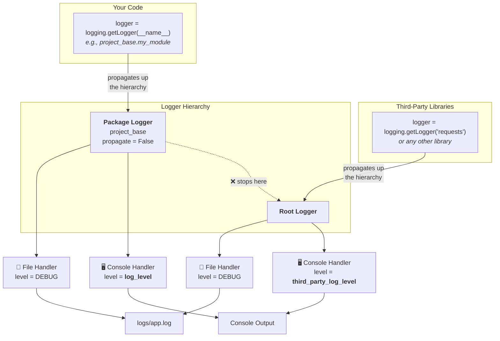

# Logging

Logging is automatically configured the moment you import `project_base`. No setup code needed, just start logging.

```python
import logging

import project_base  # Logging is now configured

logger = logging.getLogger(__name__)
logger.info("Ready to go.")
```

## What You Get

- **Zero-setup logging** that works on import.
- **Dual output:** every log goes to both the console and a persistent file in `logs/`.
- **Independent control** over your logs and third-party library logs.
- **Automatic log file rotation** with timestamped backups when files exceed 10 MB.
- **Correlation IDs** that trace requests across your entire application (for API services).
- **Uncaught exception logging** so crashes are captured in the log file.

## Quick Start

### Create a logger

Use Python's standard `logging.getLogger(__name__)` in every module:

```python
import logging

logger = logging.getLogger(__name__)

def process_data(data: list[dict]) -> list[dict]:
    logger.info("Processing %d records", len(data))
    # ...
    logger.debug("Finished processing")
    return data
```

That's it. The logger inherits all the configuration that `project_base` set up for you. No handlers, formatters, or levels to configure per-module.

!!! tip "Always use `__name__`"

    `__name__` resolves to the module's dotted path (e.g., `project_base.some_module`). This is what makes the logger hierarchy work: your logs flow to the right handlers automatically.

### Check your configuration

Logging levels live in `config.yaml`:

```yaml
logging:
  log_level: INFO                  # Your application's console log level
  third_party_log_level: WARNING   # Console log level for dependencies
```

You can override these per-environment (e.g., `config.dev.yaml`) or locally (`config.local.yaml`) using the [configuration system](configuration.md).

## Libraries vs applications

!!! tip "Summary"
    If you're an application, you don't need to do anything else. If you're a library, remove the `configure_logging` call from `__init__.py`.

The `configure_logging` call in `__init__.py` is intentional for **applications** (programs with a single entry point that you run directly like a FastAPI service, a batch pipeline, a CLI tool). Applications own their logging configuration.

**Libraries** (packages imported by other code) must never configure logging themselves. A library is code that does not have its own entry point and exists to be used by an application or another library. If a library calls `configure_logging` on import, it hijacks handler and level settings for whoever imports it, potentially suppressing or corrupting that caller's own log output.

If you are writing a library, remove the `configure_logging` call (and the import of `configure_logging`) from `__init__.py`. Your callers will configure logging themselves.

## How Logs Flow

The logging system uses Python's logger hierarchy to separate your application logs from third-party library logs. This gives you independent control over what reaches your console while ensuring **everything** ends up in the log file.



**Key points:**

- Your code's loggers (named `project_base.*`) propagate up to the **package logger**, which has `propagate = False`. This means your logs never reach the root logger — no duplicates.
- Third-party loggers (e.g., `urllib3`, `httpx`) propagate to the **root logger**.
- Each logger has its own console handler with its own level, so you can show `DEBUG` for your code while keeping third-party noise at `WARNING`.
- Both loggers have a file handler set to `DEBUG` — the log file captures everything regardless of console settings.

## Console vs. File

| Destination               | What gets logged                   | Level control                     |
| ------------------------- | ---------------------------------- | --------------------------------- |
| **Console** (your code)   | Logs from `project_base.*` loggers | `log_level` in config             |
| **Console** (third-party) | Logs from all other loggers        | `third_party_log_level` in config |
| **File** (`logs/app.log`) | All logs from all sources          | Always `DEBUG`                    |

The file always captures everything. When you're debugging a production issue, the answer is often
already in the log file even if it wasn't visible in the console.

### Log format

All log lines follow this format:

```shell
2025-04-28 14:30:00,123 - INFO - project_base.my_module.process_data:42 - Processing 100 records
```

That is: `timestamp - level - logger_name.function:line - message`.

### Log file rotation

When `logs/app.log` exceeds 10 MB, it is automatically renamed with a timestamp
(e.g., `app_20250428T143000.123456Z.log`) and a fresh `app.log` is started.

!!! warning "Disk space management"

    Since old log files are never deleted, you'll want a pruning strategy for long-running applications. A simple cron job that deletes files older than N days works well:

    ```bash
    find logs/ -name "app_*.log" -mtime +30 -delete
    ```

!!! tip "Jumping between executions"

    Each time the application starts, a `========== NEW EXECUTION ==========` line is written to the log file. Search for that string in `logs/app.log` to quickly navigate between runs.

## Logging from concurrent code

Reading logs from concurrent (or parallel) code may be difficult, since logs emitted from each "track" get mixed with others. To solve this, we may use Correlation IDs.

The provided setup will prefix all emitted logs with the value of the `asgi_correlation_id.context.correlation_id` context variable, which may be safely set in concurrent and parallel execution. This allows you to filter logs by searching for the known ID.

### How it works

1. Some piece of code assigns a value (such as a UUID) to the `asgi_correlation_id.context.correlation_id` [`ContextVar`](https://docs.python.org/3/library/contextvars.html). This is what ensures that each request in an `async` API gets its own trace ID for logs.
2. A `CorrelationIdFilter` (from `asgi-correlation-id`) is attached to every log handler. It reads the `ContextVar` and adds a `correlation_id` attribute to each `LogRecord`.

    !!! note
        This filter never actually filters anything. It's just a code trick, because all `LogRecords` pass through filters.

3. Our `CorrelationIdFormatter` checks for that attribute and, if present, prefixes the message with `[correlation_id]`.

When no correlation ID is set (e.g., in scripts or CLI tools), logs look exactly as normal.

!!! tip "Accessing the correlation ID"

    You can read the current ID from anywhere:

    ```python
    from asgi_correlation_id import correlation_id

    current_id = correlation_id.get()
    ```

    This is useful for returning the ID to clients in error responses, for example.

### FastAPI

When building APIs, you may want to trace a request across all log messages it produces. To do so, simply use the `CorrelationIdMiddleware` which will set the correlation ID for logs, and also include it in an `X-Request-ID` header in the response (useful for tracking).

```python
import uuid

from asgi_correlation_id import CorrelationIdMiddleware
from fastapi import FastAPI

import project_base  # Logging is ready

app = FastAPI()
app.add_middleware(CorrelationIdMiddleware, generator=lambda: str(uuid.uuid4()))
```

Once the middleware is active, every log message produced during a request gets prefixed with the request's correlation ID:

```shell
2025-04-28 14:30:00,123 - INFO - project_base.api.handlers.get_users:18 - [e8f9a1b2-...] Fetching user list
2025-04-28 14:30:00,456 - DEBUG - project_base.db.queries.find_users:33 - [e8f9a1b2-...] Query returned 42 rows
```

!!! warning
    To also include the request ID header when there's some API error (you _really_ want this), follow [this](https://github.com/snok/asgi-correlation-id#fastapi-1) tutorial.

You can then filter your logs by ID to see everything that happened during a single request, even across modules and async tasks.

### General solution

While `asgi_correlation_id` comes with a FastAPI middleware that simplifies things, ensuring logs get prefixed with the correlation ID is as simple as setting the value of `asgi_correlation_id.context.correlation_id`.

This means that, for parallel jobs that run in the same machine, or threading/multiprocessing/whatever, you can get away with running this:

```python
from asgi_correlation_id.context import correlation_id
import uuid

_id = str(uuid.uuid4())  # Any string acting as a thread_id/process_id/whatever_id
correlation_id.set(str(uuid.uuid4()))
```

## The `__main__` Logger

When you run a Python file directly (e.g., `python my_script.py`), the module's `__name__` is
`"__main__"` instead of its dotted path. The logging system handles this — a dedicated
`__main__` logger is configured with the same handlers and levels as your package logger.

This means scripts work correctly without any special treatment:

```python
# scripts/run_pipeline.py
import logging

import project_base

logger = logging.getLogger(__name__)  # This is "__main__" when run directly
logger.info("Pipeline starting")     # Works just fine
```

## Uncaught Exceptions

If your program crashes with an unhandled exception, it gets logged as an `ERROR` before Python's
normal traceback is shown. This ensures crashes are always captured in `logs/app.log`, even if no
one was watching the console.

## Deep Dive

For implementation details — logger hierarchy internals, handler configuration, and the reasoning
behind design decisions — see the [Logging Internals](../tutorials/logging_internals.md) page.
