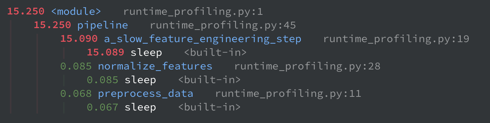
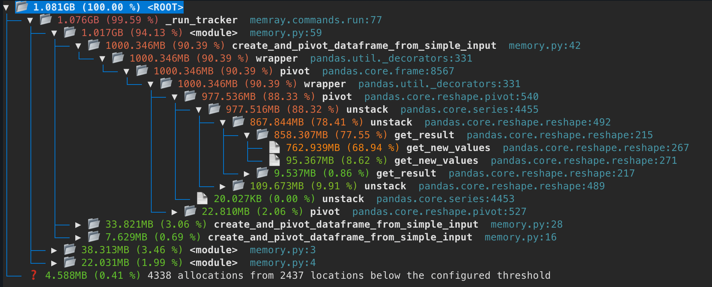

# Runtime and Memory Profiling

The template includes integration with modern Python profiling tools to help you optimize performance.

By incorporating `pyinstrument` and `memray` into your development workflow, you'll be better equipped to build high-performance, memory-efficient machine learning solutions for our clients. Remember to profile early and often, especially when dealing with large datasets or complex computations.

## `pyinstrument`: statistical profiling for runtime

[`pyinstrument`](https://pyinstrument.readthedocs.io/) is a statistical profiler, meaning it interrupts the program at regular intervals (e.g., every millisecond) and records the entire call stack at that moment. It's particularly good at identifying functions that consume much of the total execution time.

### How to use `pyinstrument`

1. Call your Python script from pyinstrument: `pyinstrument your_script.py`.
2. Analyze the results.

### When to use `pyinstrument`

- Identifying performance bottlenecks
- Optimizing CPU-intensive code
- Understanding execution flow
- Comparing performance improvements

### Why use `pyinstrument`

- **Low overhead:** Minimal impact on execution time.
- **Statistical sampling:** Accurate performance measurements.
- **Call stack analysis:** See which functions are slowest.
- **Web interface:** Interactive profiling results.

### `pyinstrument` example

Let's consider a typical machine learning object: a preprocessing pipeline.

??? example "Sample Code"
    ```python title="runtime_profiling.py"
    import time
    import random

    def load_initial_data(item_id):
        """Simulates loading some raw data."""
        time.sleep(0.0001) # Very fast operation.
        return {"id": item_id, "value": random.randint(1, 100), "status": "raw"}

    def preprocess_data(data):
        """Simulates some initial preprocessing."""
        time.sleep(0.001) # A bit slower.
        data["status"] = "preprocessed"
        data["value"] = data["value"] * 1.1
        return data

    def a_slow_feature_engineering_step(data):
        """This is our intentionally slow function."""
        # Simulate a computationally expensive task or an inefficient operation.
        time.sleep(0.5) # Significantly slower than other steps
        data["features"] = [data["value"] / (i+1) for i in range(5)]
        data["status"] = "features_engineered"
        return data

    def normalize_features(data):
        """Simulates normalizing the generated features."""
        time.sleep(0.002)
        if "features" in data:
            max_val = max(data["features"]) if data["features"] else 1
            data["normalized_features"] = [f / max_val for f in data["features"]]
        data["status"] = "normalized"
        return data

    def finalize_data_item(data):
        """Simulates final checks or formatting."""
        time.sleep(0.0005) # Quick final step
        data["status"] = "finalized"
        return data

    def pipeline(num_items=50):
        """The main function that orchestrates the data processing."""
        print(f"Starting processing pipeline for {num_items} items...")
        final_results = []
        for i in range(num_items):
            raw_item_data = load_initial_data(i)
            preprocessed_item_data = preprocess_data(raw_item_data)
            engineered_features_data = a_slow_feature_engineering_step(preprocessed_item_data)
            normalized_data = normalize_features(engineered_features_data)
            final_item_data = finalize_data_item(normalized_data)
            final_results.append(final_item_data)
            if (i + 1) % 10 == 0:
                print(f"Processed {i+1}/{num_items} items...")
        print("Processing pipeline finished.")
        return final_results

    if __name__ == "__main__":
        results = pipeline(num_items=30)
    ```

1. Run the profiler: `pyinstrument --renderer=html --outfile=report.html runtime_profiling.py`.
2. Inspect the `report.html` file.
    

When `pyinstrument` runs the script, it tracks the time spent in each function. The output (usually an HTML file, or text in the console) shows a call tree, where you can clearly see that:

- The `pipeline` function takes up most of the total time.
- The call to `a_slow_feature_engineering_step` dominates the execution time within the loop. The report highlights the `sleep` line (or the operations within that function if it were real computation) as consuming most of that time.
- Other functions also show up, but their contribution is significantly smaller.

This immediately pinpoints `a_slow_feature_engineering_step` as the primary bottleneck in your data processing chain!

## `memray`: Memory Profiling for Python

[`memray`](https://bloomberg.github.io/memray/) is a memory profiler for Python that can track all memory allocations in Python code, C/C++ extension modules, and the Python interpreter itself. It can help you discover memory leaks, identify hotspots of memory allocation, and understand the overall memory footprint of your application.

### How to use `memray`

1. Call your Python script from `memray`: `memray run your_script.py`.
    1. This command executes your script and collects memory profiling data into a `.bin` file.
2. Generate a report from the several offered by `memray`.
    1. For example, the tree view is particularly useful: `memray tree your/memray.bin`.

### When to use `memray`

- Debugging memory leaks.
- Optimizing memory-intensive applications.
- Understanding allocation patterns.
- Profiling data processing pipelines.

### Why use `memray`

- **Make your application more efficient:** Identify memory leaks and high usage to make your application use less resources, making it faster and cheaper to run.
- **Memory tracking:** Monitor memory allocation and deallocation.
- **Timeline analysis:** See memory usage over time.
- **Native extensions:** Profiles C extensions and native code with ease.

### `memray` example

Let's create a script that processes a dataset and inadvertently increases its dimensionality a lot.

??? example "Sample Code"
    ```python title="memory_profiling.py"
    import time

    import numpy as np
    import pandas as pd


    def create_and_pivot_dataframe_from_simple_input(
        num_rows_original_df=500_000, num_new_columns=200
    ):
        """Perform a memory-intensive pivot operation on a DataFrame.

        Starts with a simple DataFrame (one row per ID, with a numeric value) and pivots it to increase
        dimensionality, resulting in a big dataframe that consumes a lot of memory.
        """
        print(f"Generating initial DataFrame with {num_rows_original_df} unique IDs...")
        df = pd.DataFrame(
            {
                "id": np.arange(num_rows_original_df),  # Unique IDs
                "value_numeric": np.random.rand(num_rows_original_df),
            }
        )

        print(f"Initial DataFrame shape: {df.shape}")
        initial_memory_mb = df.memory_usage(deep=True).sum() / 1024**2
        print(f"Initial DataFrame memory usage: {initial_memory_mb:.2f} MB")

        print(f"Adding 'column_key' for {num_new_columns} potential new columns...")
        df["column_key"] = [
            f"COL_KEY_{i % num_new_columns}" for i in range(num_rows_original_df)
        ]

        memory_after_key_mb = df.memory_usage(deep=True).sum() / 1024**2
        print(
            f"DataFrame memory usage (after adding key): {memory_after_key_mb:.2f} MB."
            f"Shape: {df.shape}."
        )

        print(
            f"Pivoting DataFrame. Expected shape: ({num_rows_original_df}, {num_new_columns})."
        )

        df_pivoted = df.pivot(index="id", columns="column_key", values="value_numeric")

        final_memory_mb = df_pivoted.memory_usage(deep=True).sum() / 1024**2
        print(
            f"Pivoted DataFrame memory usage: {final_memory_mb:.2f} MB. Shape: {df_pivoted.shape}."
        )

        print("Holding data for a few seconds to allow profiler to capture...")
        time.sleep(3)

        # Clean up to observe deallocation if memray tracks it
        del df_pivoted
        del df
        time.sleep(1)


    if __name__ == "__main__":
        create_and_pivot_dataframe_from_simple_input(
            num_rows_original_df=500_000, num_new_columns=200
        )
    ```

1. Run `memray run memory_profiling.py`
2. Generate a tree report: `memray tree your/memray.bin`.
3. Inspect the report:
    

You can clearly see which parts of the script consumed the most memory (a `pivot` operation from `pandas.core.frame`), so you now know where to look if you’re having memory issues.

## Integration Tips

### Development Workflow

1. **Understand if optimization is necessary:** Before profiling and optimizing code, understand if it's even necessary.

    Are you spending too much in infrastructure and need to reduce costs? Does your API need to hit a response time target and you're way above it? Would running your code in half the time or with half the memory solve your current issue? If not, then maybe it's not yet time to jump into optimizations.

    !!! warning
        This does not enable you to write sloppy code under the guise of "optimizations" should come at a later stage. Always attempt to write clean and efficient code, given your implementation time constraints.

        There's nothing worse than getting yourself into a sticky future situation by saying "it runs fast enough now so I can afford these inefficiencies I know how to implement in a better way". Refactoring and optimization after the fact come at great development speed costs, and clients don't like that!

    As Donald Knuth best put it:

    !!! quote
        Premature optimization is the root of all evil. **Yet we should not pass up our opportunities in that critical 3%.**

2. **Measure first**: Once you've decided you need to optimize your code, always profile before optimizing. This way you can pinpoint the code paths that will give you the greatest gains with the least effort.
3. **Focus on hotspots**: Optimize the slowest parts first.
4. **Validate improvements**: Compare before/after profiles. If you can't improve performance, then maybe leave code untouched.
5. **Automate profiling**: At an advanced level, profiling can be included in CI for performance regression testing.

### Best Practices

- **Profile realistic workloads**: Use representative data.
- **Profile in production-like environments**: Similar hardware and data sizes.
- **Consider multiple metrics**: CPU time, memory, I/O.
- **Document performance requirements**: Set clear benchmarks.
