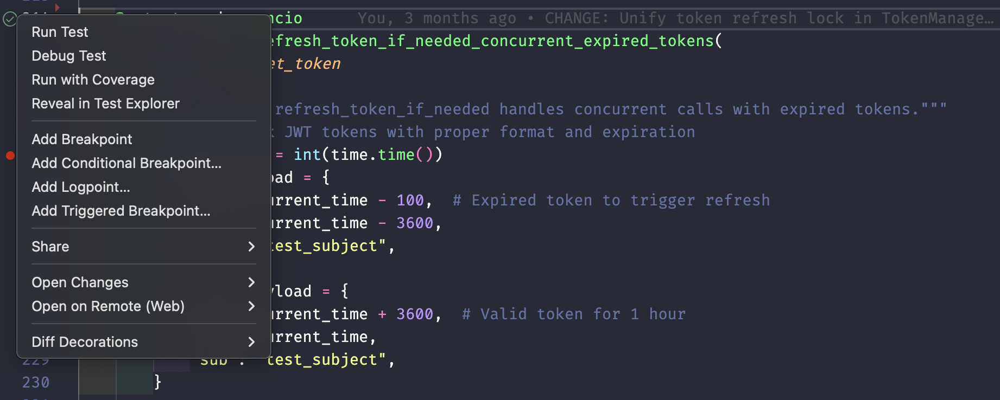

# Testing

The template is configured to use [pytest](https://pytest.org/) for testing.

## Running Tests

### VSCode

VSCode has a Testing panel, which you may access by opening the command palette (F1) and typing _Testing: Focus on Test Explorer View_.

There you can run individual tests or the whole test suite, with or without coverage.

You can even debug tests by adding breakpoints and clicking Debug Test next to the individual test.



### Terminal

You may use `just test` or `just test-coverage` to run tests in the terminal.

To run specific tests, see `uv run pytest --help`.

## Coverage Requirements

### What is Coverage?

Test coverage measures how much of your code is executed during tests. It helps identify:

- Untested code paths.
- Missing test cases.
- Dead code.

### Configuration

Minimum coverage amounts are enforced by CI/CD. See the `just test-coverage` command for configuration.

You may further configure coverage by using the `[tool.coverage.report]` table in `pyproject.toml`.

### Test Organization

```text
tests/
├── __init__.py
├── test_module1.py      # Tests for module1
├── test_module2.py      # Tests for module2
└── conftest.py          # Shared test fixtures
```

### Best Practices

1. **One test file per module:** `test_module.py` for `module.py`.
2. **Use test classes to group testing:** Sometimes you want to group test functions by some criteria. You may use normal classes within your test modules to do this.
3. **Descriptive test names:** `test_should_return_user_when_valid_id()`.
4. **Use fixtures:** For setup and teardown.
5. **Test edge cases:** Error conditions, boundary values.
6. **Keep tests fast:** Use mocks for external dependencies, like queries to databases or internet requests.

## Async Testing

The template includes [pytest-asyncio](https://pytest-asyncio.readthedocs.io/) for testing asynchronous code.

### Writing Async Tests

Simply define test functions as `async def`. No decorators needed:

```python
async def test_async_operation() -> None:
    """Test an async function."""
    result = await my_async_function()
    assert result == expected
```

Aside from autodetecting and running async def tests, you can declare async fixtures as usual by decorating async functions with @pytest.fixture :

```python
import pytest

@pytest.fixture
async def async_client():
    """Create an async client."""
    client = await create_client()
    yield client
    await client.close()

async def test_with_fixture(async_client) -> None:
    """Use the async fixture."""
    response = await async_client.get("/api")
    assert response.status == 200
```

You may also mock async resources using `unittest.mock.AsyncMock` instead of the normal `unittest.mock.MagicMock`.
