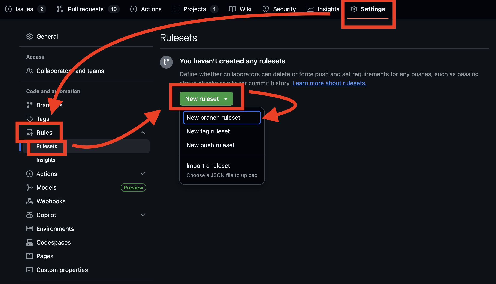

# Configuring your GitHub Repository with sane defaults

This page describes reasonable settings for your GitHub repo that'll make your life easier if configured.

## Add missing branches

Once you've determined if you'll use a `dev` branch, you should create it in the remote by running

```shell
git switch --create dev
git push origin dev
```

## General Settings

Navigate to **Settings** and under **Pull Requests** and check **Automatically delete head branches**. This deletes branches from GitHub when you merge a PR, keeping the repo lean.

## Branch protection rules

Rulesets help you to control how people can interact with branches and tags in a repository. We recommend you set up at least one branch ruleset to prevent accidental pushing and merging to relevant branches.

You can create rulesets by:

1. Navigate to **Settings**.
2. Click on **Rulesets** in your GitHub repository.
3. Click on New Ruleset.
4. Click on New Branch Ruleset.
    
5. Write the ruleset name: *Approvals and Checks*.
6. Choose *Active* as the Enforcement Status.

7. Add Target Branches.

    1. In the Target Branches section click on *Add target*.
    2. Click on *Include by pattern*.
    3. Type `main`.
    4. Repeat steps a-c for other branches, like `dev`.

8. Configure the ruleset.

    1. Check *Restrict deletions*.
    2. Check *Require a pull request before merging*.
        1. Set at least `1` minimum approval.
        2. Leave all other options unchecked.

            !!! note
                This is a matter of preference, but requiring conversation resolution and enabling any option that dismisses submitted approvals can be very annoying for users that just rebase their branch before a merge.

    3. Check *Require status checks to pass*.

        1. Check *Require branches to be up to date before merging*.

            !!! info
                This forces users to rebase their branches before merging, which should ensure they re-test their changes with any new code from the target branch.

        2. In the required checks section click *Add checks*.

            1. Select at least `code-quality` and `check-pr-style`.

    4. Check block force pushes.

## Code Security and Analysis

Go to **Settings** > **Advanced Security** and enable the following:

- **Dependency Graph:** Helps visualize project dependencies.
- **Dependabot alerts:** Receive alerts for vulnerabilities that affect your dependencies and manually generate Dependabot pull requests to resolve these vulnerabilities.
- **Dependabot security updates:**: Enabling this option will result in Dependabot automatically attempting to open pull requests to resolve every open Dependabot alert with an available patch.
- **Grouped security updates:** Groups all available updates that resolve a Dependabot alert into one pull request (per package manager and directory of requirement manifests).

All alerts will be shown in the `Security` tab, inside Dependabot.
