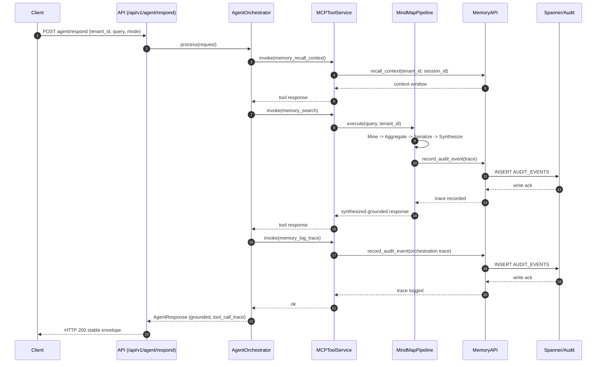

# Technical Report and Codebase Navigation Guide

Date: 2026-06-18
Version: Phase 4 hardening baseline
Audience: Engineers onboarding to the repository for the first time

## 1. Why this document exists

This report is intentionally explanatory. It is not only a status summary, it is a map of:

- where key concepts live in the repository,
- how information moves through the system,
- what each main script and module does,
- and how to start making safe changes quickly.

If you are new to this codebase, start here before diving into implementation files.

## 2. System in one page

The project is a GCP-native memory platform for AI agents. It is built to reduce hallucinations and improve trust by forcing responses to be grounded in graph evidence.

Core ideas:

- Tripartite memory model:
  - CONTEXT (short-term session state)
  - SEMANTIC (durable facts and relationships)
  - AUDIT (immutable operation trace)
- Deterministic reasoning path: Mine -> Aggregate -> Serialize -> Synthesize
- Safety posture:
  - tenant-aware boundaries,
  - validation at API and tool layers,
  - redacted client-safe errors,
  - append-only audit behavior.

## 3. Repository map for first-time navigation

High-value starting points:

- API entrypoint: [src/api/main.py](src/api/main.py)
- Orchestration: [src/agent/orchestrator.py](src/agent/orchestrator.py)
- MCP tool layer: [src/mcp/service.py](src/mcp/service.py)
- MindMap pipeline: [src/memory/mindmap_pipeline.py](src/memory/mindmap_pipeline.py)
- Memory CRUD and audit writes: [src/memory/api.py](src/memory/api.py)
- Spanner access and mutation guards: [src/db/spanner_client.py](src/db/spanner_client.py)
- Observability primitives:
  - [src/observability/logging.py](src/observability/logging.py)
  - [src/observability/tracing.py](src/observability/tracing.py)
  - [src/observability/metrics.py](src/observability/metrics.py)
- Input validation rules: [src/security/validators.py](src/security/validators.py)
- Models and contracts: [src/models](src/models)

Project-level scaffolding:

- Task runner: [justfile](justfile)
- Dependencies and tool config: [pyproject.toml](pyproject.toml)
- Roadmap: [DEVELOPMENT_PLAN.md](DEVELOPMENT_PLAN.md)
- Docs root: [docs](docs)
- Tests root: [tests](tests)
- Utility scripts: [scripts](scripts)

## 4. Flow of information and actions

### 4.1 API lifecycle

Request lifecycle starts in [src/api/main.py](src/api/main.py):

1. App startup (lifespan)
  - Loads settings and logging configuration.
  - Configures tracing.
  - Leaves Spanner initialization lazy (on demand).

2. Request routing
  - /api/v1/agent/respond -> orchestrator flow
  - /api/v1/mcp/invoke -> direct MCP tool invocation
  - /api/v1/mindmap/execute -> direct MindMap pipeline execution

3. Error mapping
  - Exceptions are wrapped into stable envelopes.
  - Request validation is sanitized into client-safe field guidance.
  - Internal stack details are not exposed in client responses.

### 4.2 Agent request flow

The main product flow is in [src/agent/orchestrator.py](src/agent/orchestrator.py):

1. Receive tenant-scoped request and choose mode:
  - single
  - supervisor_worker
  - vertex (if adapter is configured)

2. Invoke MCP tools (tool trace is captured)
  - recall context
  - search memory
  - log orchestration trace

3. Build final response
  - extract synthesis result from search response
  - return grounded flag and tool call trace metadata



### 4.3 MCP tool flow

The MCP contract layer is [src/mcp/service.py](src/mcp/service.py):

1. Validate request fields and tenant context.
2. Route to one tool implementation:
  - memory_search
  - memory_add_fact
  - memory_log_trace
  - memory_recall_context
3. Wrap output in MCPInvokeResponse.
4. Emit logs, metrics, and token usage estimate.
5. Return stable typed success or error payload.

### 4.4 MindMap pipeline flow

The deterministic reasoning pipeline is [src/memory/mindmap_pipeline.py](src/memory/mindmap_pipeline.py):

1. Mine
  - Extract query entities and intent.
  - Deterministic adapter or Vertex-based adapter depending on config.

2. Aggregate
  - Traverse evidence graph via deterministic or Spanner-backed adapter.
  - Apply traversal and horizon bounds.

3. Serialize
  - Convert paths/edges into canonical facts.
  - Produce traceable fact IDs and markdown payload.

4. Synthesize
  - Build grounded summary from serialized facts.
  - If no facts exist, return explicit insufficiency.

5. Validate grounding
  - Ensure all referenced fact IDs exist in serialized evidence.
  - Fail closed if claim references unknown fact.

6. Emit observability and trace record
  - metrics and logs
  - trace recorder writes audit event (tenant-aware)

### 4.5 Memory API and persistence flow

Persistence-facing behavior is in [src/memory/api.py](src/memory/api.py):

- Session creation into context tier.
- Semantic fact insertion with optional relationships.
- Audit event append-only writes.
- Context recall windows.
- Weight updates and tier checks.

Data access guardrails are in [src/db/spanner_client.py](src/db/spanner_client.py):

- Singleton client pattern.
- Query/update helpers.
- DML target extraction.
- Explicit protection against non-insert operations on AUDIT_EVENTS.

## 5. What happens at each endpoint

### GET /health

- File: [src/api/main.py](src/api/main.py)
- Returns basic service status and timestamp.
- Used for liveness/sanity in local and deployed environments.

### POST /api/v1/mindmap/execute

- File: [src/api/main.py](src/api/main.py)
- Direct call into MindMap pipeline.
- Useful for testing reasoning stages independently of full orchestration.

### POST /api/v1/mcp/invoke

- File: [src/api/main.py](src/api/main.py)
- Routes into MCP service in [src/mcp/service.py](src/mcp/service.py).
- Primary machine contract for tool-level operations.

### POST /api/v1/agent/respond

- File: [src/api/main.py](src/api/main.py)
- Calls orchestrator in [src/agent/orchestrator.py](src/agent/orchestrator.py).
- This is the end-to-end multi-tool agent turn path.

### POST /internal/decay-weights and /internal/prune-weights

- File: [src/api/main.py](src/api/main.py)
- Calls [src/memory/cognitive_weighting.py](src/memory/cognitive_weighting.py).
- Intended for operational maintenance and scheduled lifecycle control.

## 6. Scripts: what each one does and when to use it

Scripts directory: [scripts](scripts)

### deploy-phase1.sh

- File: [scripts/deploy-phase1.sh](scripts/deploy-phase1.sh)
- Legacy Phase 1 bootstrap and verification helper.
- Includes env setup, test execution, checklist output, and deployment hints.

### render_phase3_cloudrun_manifest.py

- File: [scripts/render_phase3_cloudrun_manifest.py](scripts/render_phase3_cloudrun_manifest.py)
- Renders Cloud Run YAML template placeholders for Phase 3 deployment pipeline.
- Used by just tasks for deployment scaffolding.

### start-emulator.sh

- File: [scripts/start-emulator.sh](scripts/start-emulator.sh)
- Starts and initializes local Spanner emulator instance/database.
- Useful for local integration flows against Spanner-like behavior.

### generate_api_reference_documentation.py

- File: [scripts/generate_api_reference_documentation.py](scripts/generate_api_reference_documentation.py)
- Generates mkdocs API reference pages from Python source tree.
- Helps keep API docs synchronized with code structure.

### code_complexity_metrics.py

- File: [scripts/code_complexity_metrics.py](scripts/code_complexity_metrics.py)
- Radon-based complexity/maintainability metrics report.
- Useful for refactoring prioritization and quality trend tracking.

### github_metrics.py

- File: [scripts/github_metrics.py](scripts/github_metrics.py)
- Collects GitHub-based delivery and workflow metrics.
- Intended for engineering reporting and throughput diagnostics.

### extract_necessary_pre_commit_types.py

- File: [scripts/extract_necessary_pre_commit_types.py](scripts/extract_necessary_pre_commit_types.py)
- Parses .pre-commit-config.yaml and emits needed hook stages.
- Used by just setup-hooks.

### select_python.py

- File: [scripts/select_python.py](scripts/select_python.py)
- Interactive helper for selecting Python version from official release-cycle metadata.

### toml_replacer.py

- File: [scripts/toml_replacer.py](scripts/toml_replacer.py)
- Merges sections from source TOML into target TOML while preserving structure/comments.

## 7. Testing strategy and where to look first

Tests root: [tests](tests)

Recommended onboarding sequence:

1. Read contract tests for API behavior:
  - [tests/unit/test_security_audit.py](tests/unit/test_security_audit.py)
  - [tests/unit/test_observability_safety.py](tests/unit/test_observability_safety.py)

2. Read pipeline behavior tests:
  - [tests/unit/test_mindmap_pipeline.py](tests/unit/test_mindmap_pipeline.py)

3. Read orchestration/tool integration tests:
  - [tests/unit/test_agent_orchestrator.py](tests/unit/test_agent_orchestrator.py)
  - [tests/unit/test_mcp_api.py](tests/unit/test_mcp_api.py)

4. Read memory and audit data behavior tests:
  - [tests/unit/test_memory_api.py](tests/unit/test_memory_api.py)
  - [tests/integration/test_audit_trail.py](tests/integration/test_audit_trail.py)

Core validation command:

```bash
just check-all
```

## 8. First-week onboarding path (practical)

Day 1:
- Run install and baseline checks.
- Call /health and /api/v1/agent/respond locally.

Day 2:
- Trace one request end-to-end:
  - main.py -> orchestrator.py -> mcp/service.py -> mindmap_pipeline.py -> memory/api.py

Day 3:
- Read one complete test file from each domain (security, pipeline, memory).

Day 4:
- Make a small change in one layer (for example validation message formatting) and run targeted tests.

Day 5:
- Run full quality gate and document learning in docs or ADR notes.

## 9. Known friction points for new contributors

- Some scripts are historical and phase-specific (for example deploy-phase1.sh).
- There are multiple paths to invoke reasoning (direct MindMap vs MCP vs orchestrator).
- Observability concerns span several modules (logging, tracing, metrics, API handlers).

Mitigation:
- Use this report as an entry map.
- Follow request flow sections before changing cross-cutting behavior.
- Use focused tests first, then full quality gate.

## 10. Conclusion

This repository is organized around explicit layers:

- API boundary,
- orchestration,
- tool contract,
- reasoning pipeline,
- memory persistence,
- and observability.

For first-time contributors, the fastest path to confidence is to follow one request through those layers, then anchor each concept to the tests and scripts listed above.
