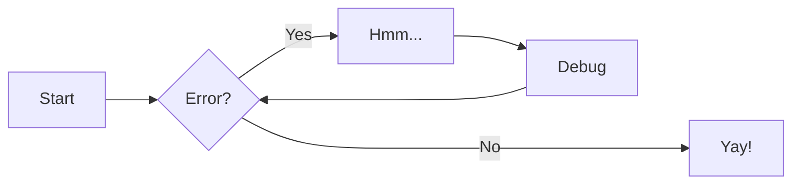

# Documentation basics

This page provides *brief* tutorials for doing some things you'll probably want to do while documenting.

For more advanced MkDocs usage, see the [MkDocs documentation](https://www.mkdocs.org/) and [Material for MkDocs documentation](https://squidfunk.github.io/mkdocs-material/).

## Add New Tabs, Pages or Subpages

To add a new tab or page to the documentation:

1. **Create the Markdown file:** Place your new `.md` file in the appropriate folder under `docs/` (e.g., `docs/batteries/new_feature.md`).
2. **Edit `mkdocs.yml`** to include the new page.
    - To add a tab, add an entry for your new page directly under the `nav:` section. For example:

        ```yaml
        nav:
            - New Feature: batteries/new_feature.md
        ```

    - To create subpages, nest them under a parent tab:

        ```yaml
        nav:
        - Batteries:
            - New Feature: batteries/new_feature.md
            - Another Page: batteries/another_page.md
        ```

## Add Code Blocks

You may add code with triple backticks. Don't forget to include the block's language after the ```.

```python
def hello():
    print("Hello, world!")
```

See more in [Material's code page](https://squidfunk.github.io/mkdocs-material/reference/code-blocks/).

## Add pretty notes, tips, or warnings (admonitions)

Use admonitions for notes, warnings, etc. You can use them by typing either:

- `!!!`: Normal.
- `???`: Collapsible (default closed).
- `???+`: Collapsible (default opened).

Note that the content within the admonition has to be indented one level further than the `!!!` or `???`. For example:

```markdown
!!! note
    This is a note
```

Here are all default supported types:

!!! note
    Lorem ipsum dolor sit amet, consectetur adipiscing elit. Nulla et euismod nulla. Curabitur feugiat, tortor non consequat finibus, justo purus auctor massa, nec semper lorem quam in massa.

!!! abstract
    Lorem ipsum dolor sit amet, consectetur adipiscing elit. Nulla et euismod nulla. Curabitur feugiat, tortor non consequat finibus, justo purus auctor massa, nec semper lorem quam in massa.

!!! info
    Lorem ipsum dolor sit amet, consectetur adipiscing elit. Nulla et euismod nulla. Curabitur feugiat, tortor non consequat finibus, justo purus auctor massa, nec semper lorem quam in massa.

!!! tip
    Lorem ipsum dolor sit amet, consectetur adipiscing elit. Nulla et euismod nulla. Curabitur feugiat, tortor non consequat finibus, justo purus auctor massa, nec semper lorem quam in massa.

!!! success
    Lorem ipsum dolor sit amet, consectetur adipiscing elit. Nulla et euismod nulla. Curabitur feugiat, tortor non consequat finibus, justo purus auctor massa, nec semper lorem quam in massa.

!!! question
    Lorem ipsum dolor sit amet, consectetur adipiscing elit. Nulla et euismod nulla. Curabitur feugiat, tortor non consequat finibus, justo purus auctor massa, nec semper lorem quam in massa.

!!! warning
    Lorem ipsum dolor sit amet, consectetur adipiscing elit. Nulla et euismod nulla. Curabitur feugiat, tortor non consequat finibus, justo purus auctor massa, nec semper lorem quam in massa.

!!! failure
    Lorem ipsum dolor sit amet, consectetur adipiscing elit. Nulla et euismod nulla. Curabitur feugiat, tortor non consequat finibus, justo purus auctor massa, nec semper lorem quam in massa.

!!! danger
    Lorem ipsum dolor sit amet, consectetur adipiscing elit. Nulla et euismod nulla. Curabitur feugiat, tortor non consequat finibus, justo purus auctor massa, nec semper lorem quam in massa.

!!! bug
    Lorem ipsum dolor sit amet, consectetur adipiscing elit. Nulla et euismod nulla. Curabitur feugiat, tortor non consequat finibus, justo purus auctor massa, nec semper lorem quam in massa.

!!! example
    Lorem ipsum dolor sit amet, consectetur adipiscing elit. Nulla et euismod nulla. Curabitur feugiat, tortor non consequat finibus, justo purus auctor massa, nec semper lorem quam in massa.

!!! quote
    Lorem ipsum dolor sit amet, consectetur adipiscing elit. Nulla et euismod nulla. Curabitur feugiat, tortor non consequat finibus, justo purus auctor massa, nec semper lorem quam in massa.

See more in [Material's admonitions page](https://squidfunk.github.io/mkdocs-material/reference/admonitions/#supported-types).

## Add `mermaid` diagrams

Just add them as normal code blocks with `mermaid` as the language:

```` markdown title="Flow chart"

````

<div class="result" markdown>


</div>

## Add math or LaTeX

To add $\LaTeX$, simply type it within `$...$` or `\(...\)` for inline or within `$$...$$` or `\[...\]` for blocks.

``` latex title="block syntax"
$$
\cos x=\sum_{k=0}^{\infty}\frac{(-1)^k}{(2k)!}x^{2k}
$$
```

<div class="result" markdown>

$$
\cos x=\sum_{k=0}^{\infty}\frac{(-1)^k}{(2k)!}x^{2k}
$$

</div>

## Link to another page

- Use relative links: `[See Testing](../testing.md)`.
  - You may add `#heading-name` after the page to link to a specific anchor.
- Within a page, you may specify only the specific anchor: `[Go to Section](#section-title)`.

## Add Images and Assets

- Place images in `docs/assets/` and reference them in markdown:

```markdown

```

## Link to Code

To link to code in your documentation, you must directly link to the file on GitHub.

```markdown
[See src.py on GitHub](https://github.com/tryolabs/repo-template/blob/main/src/project_base/src.py)
```

!!! tip
    To keep the link "always up to date", link to the `blob/main` path instead of using a permalink.

## Subscripts and superscripts

You may use `~` and `^` for this:

```` markdown title="Subscripts and superscripts"
H~2~O

A^T^A
````

<div class="result" markdown>

H~2~O

A^T^A

</div>

## Highlight text

You may use `==` for this:

```` markdown title="Highlights"
You may ==highlight== text like ==this==.
````

<div class="result" markdown>

You may ==highlight== text like ==this==.

</div>

## Footnotes

You can add footnotes by adding a `[^N]` tag where you want the footnote to be, and `[^N]:` at the bottom of the file.