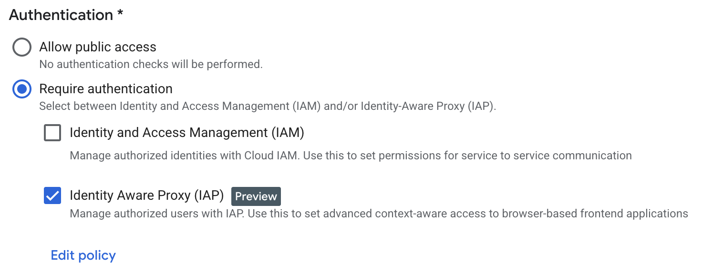

# Standard deploy

The Repo Template's documentation is hosted in GCP using a combination of services: a Cloud Run Service running an `nginx` static site server, which pulls the files from a GCS Bucket that's mounted to the container, and which is protected with IAP to only allow access to people with an `@tryolabs.com` account.

This method, in [multisite mode](#multisite), is what we use for [`documentation.tryolabs.com`](https://documentation.tryolabs.com).

!!! note
    You may use the Tryolabs' `tryo-documentation` GCP project and provided server images to host client documentation if necessary. You just need to ensure that you create a new Cloud Run Service with proper IAP, and a new Bucket to host client docs.

    To request access, please [open a ticket with IT](https://www.notion.so/IT-Support-1e594de3c1b7804fb87cf8e677621daa).

## Deployment modes

We provide guidance for 2 hosting methods: multisite and single site.

!!! info
    The template's provided infra is set up in multisite mode.

### Multisite

In **multisite mode**, you may host multiple static websites under a single URL (i.e. multiple projects under a single Cloud Run Service).

This is useful when you want simple infrastructure but you still want to host documentation for multiple projects under one URL, with the caveat that authentication is uniform for all subsites.

This method mandates that you suffix the URL to your Cloud Run Service with your project's name.

### Single site

In **single site mode** you'll host a single site per URL (i.e., a single project per Cloud Run Service).

This allows for more fine grained access control, since every Cloud Run Service can have a unique IAP configuration.

However, you'll need to manually (for now) set up each deployment, which can be tedious (though setup is mostly one-and-done).

## Setup

The setup is mostly the same regardless of the mode. The only differences are the Docker Image you use, the structure within the Bucket and the mountpoint.

### Pre-requisites

You must have the `gcloud` CLI installed, available and logged in.

If you'll be pushing Docker images (i.e., if not using one of the provided ones in our GCP project), you must also have the `docker` CLI installed and available.

### Determine your GCP Region

First, determine the region where you want to host your resources. Things to consider:

- Whether your client already has a preferred zone.
- Where the consumers of this documentation live and will access it from.

In reality, given this is very lightweight, the decision won't matter that much. But it still makes sense to analyze.

If you have no strong preferences, default to `us-central1`, which is a Low CO~2~ datacenter.

### Setup a location to host the server's Docker Image

We'll use Google Artifact Registry for this. We have to create a repo and configure your `docker` CLI so you can push there.

!!! info
    The repo template's preconfigured one is called `documentation` within the `tryo-documentation` project. You may use that one if you need to push a different kind of server and have no strong reasons to use your own repo.

Follow these steps:

1. Click on the button and **Enable** the Artifact Registry API.

    [Enable Artifact Registry API :material-google-cloud:](https://console.developers.google.com/apis/api/artifactregistry.googleapis.com/overview){ .md-button style="display: block; margin: 0 auto; width: fit-content;" target="_blank"}

2. Click the button to create a new repo[^1]:

    [Create repository :octicons-container-24:](https://console.cloud.google.com/artifacts/create-repo){ .md-button style="display: block; margin: 0 auto; width: fit-content;" target="_blank"}

3. Fill the repository form.
    1. For name pick something unique and clear (such as `documentation`).
    2. Under *Format* pick *Docker*.
    3. Under *Mode* pick *Standard*.
    4. Under *Location Type* pick *Region*.
    5. In the *Region* dropdown select your chosen GCP region.
    6. Leave the rest on default.
    7. Click on *Create*.

4. Go back to the [Repository Browser](https://console.cloud.google.com/artifacts/browse).
5. Open your repo by clicking on its name.
6. Click on *Setup Instructions* up top.
7. Follow the instructions to set up the repo locally.

    This will prompt you to configure `gcloud` and run something like `gcloud auth configure-docker us-central1-docker.pkg.dev`.

### Build and push the server Image

The repo template team already hosts a server images in the official Artifact Registry, and you may reuse it in your own Cloud Run Services. See [`documentation-server`](https://console.cloud.google.com/artifacts/docker/tryo-documentation/us-central1/documentation/documentation-server?project=tryo-documentation).

If you have to build your own, follow these steps:

1. Build the image using `just build-docs-server`.
2. Prepare your images for publishing[^2].
    1. Determine your image's new tag, which must comply with the `LOCATION-docker.pkg.dev/PROJECT-ID/REPOSITORY/IMAGE` format, where

        - `LOCATION`: Is the region of your Artifact Registry repo.
        - `PROJECT-ID`: Is your GCP project ID.
        - `REPOSITORY`: Is the name of your Artifact Registry repo.
        - `IMAGE`: Is the *remote* image name. It can differ from your local filename.

    2. Tag the image using `docker tag documentation-server-<mode> <new-tag>`.

        !!! example
            `docker tag documentation-server us-central1-docker.pkg.dev/tryo-documentation/documentation/documentation-server`

3. Push the image by running `docker push` on the new tag.

    !!! example
        `docker push us-central1-docker.pkg.dev/tryo-documentation/documentation/documentation-server`

### Use a Bucket to host the documentation

We need to create a Bucket to push our documentation to.

!!! info
    To add sites to the default provided page, see [this deployment page](../../../batteries/documentation.md#deployment).

To create the bucket, follow these steps:

1. Click the button to create a new bucket[^3]:

    [Create Bucket :simple-googlecloudstorage:](https://console.cloud.google.com/storage/create-bucket){ .md-button style="display: block; margin: 0 auto; width: fit-content;" target="_blank"}

2. Fill the bucket's name.
3. Click *Continue*.
4. Click on *Region*.
5. From the dropdown, select the region you chose above.
6. Click *Continue*.
7. Ensure *Set default class* and *Standard* are selected.
8. Check *Enable Hierarchical namespace on this bucket*.
9. Click *Continue*.
10. Ensure *Enforce public access prevention on this bucket* is checked.
11. Click *Continue*.
12. Click *Create*.

### Create the Cloud Run Service

We'll now instantiate the service that runs the server process and makes it possible for users to see the documentation.

!!! note
    You must only follow these steps if you want to create a new documentation server. To add sites to the default provided page, see [this deployment page](../../../batteries/documentation.md#deployment).

Follow these steps:

1. Click the button to create a new repo[^4]:

    [Create Cloud Run Service :material-function:](https://console.cloud.google.com/run/create){ .md-button style="display: block; margin: 0 auto; width: fit-content;" target="_blank" }

2. Select *"Deploy one revision from an existing container image"*.
3. In the Container Image URL box click SELECT.
4. In the side pane, navigate to your desired image.
5. Click Select.
6. In Region select an appropriate region.
7. Configure authentication by scrolling to the *Authentication* section and...
    1. Click on *Require authentication*.
    2. Uncheck *Identity and Access Management (IAM)*.
    3. Check *Identity Aware Proxy (IAP)*.
        
    4. Click on *Edit Policy*.
    5. Add principals.

        !!! info
            A principal can be any of:

            - Google Account email: user@gmail.com
            - Google Group: admins@googlegroups.com
            - Service account: server@example.gserviceaccount.com
            - Google Workspace domain: example.com

    6. Leave the access levels dropdown blank unless you know what you're doing.

        !!! tip
            We barely do! We don't really know what this does, but leaving it blank seems to work dandily. So tread carefully if you decide to tamper with this.

    7. Click Save.

8. Set Billing to Request Based.
9. Configure auto scaling by setting minimum instances to 0.
10. Set Ingress to All.

    !!! note
        IAP will handle authentication, don't worry.

11. Expand the *Containers, Volumes, Networking, Security* dropdown.
12. Configure the server's mode.
    1. Determine the mode you want to use. Read the [modes section](#deployment-modes) for more.
    2. Go to the *Containers* tab.
    3. Go to the *Variables & Secrets* tab.
    4. Click on *+ Add Variable*.
    5. In *Name1* type `MODE`.
    6. In *Value1* type either `multi` or `single`.
13. Create a volume to mount the documentation into the container.
    1. Go to the *Volumes* tab.
    2. Click *Add Volume*.
    3. In the *Volume Type* dropdown pick *Cloud Storage bucket*.
    4. Give the volume a good name, like `live-documentation`.
    5. In the *Bucket or folder* box click *Select*.
    6. Navigate to your documentation bucket and select it.
    7. Check *Read Only*.
    8. Click *Done*.
14. Configure the volume mount.
    1. Go to the *Containers* tab.
    2. Scroll down and click on the *Volume Mounts* tab.
    3. Click on *+ Mount Volume*.
    4. Select the volume you just created from the *Name* dropdown.
    5. For mount path, write `var/www/sites`.

        !!! note
            The GCP UI already prefixes the first, necessary `/`.

    6. Click *Done*.

15. Click *Create*.

### Push your documentation

You should build your documentation ([here is a tutorial](../../../batteries/documentation.md#building)) and push it to your Bucket.

The pushing stage differs depending on the mode you're using.

#### Multisite mode push

You **must** push the contents of `site/` to a **prefix** within the bucket. That is, push the contents to a directory, not to the bucket's root.

You may do this with this command

```shell
gcloud storage rsync -r site "gs://tryolabs-documentation/$(basename "$(pwd)")" --project=tryo-documentation
```

!!! tip
    This can be done with `just docs-publish-site`!

#### Single site mode push

You **must** push the contents of `site/` to the Bucket's **root**.

You may do this with this command

```shell
gcloud storage rsync -r site "gs://tryolabs-documentation" --project=tryo-documentation
```

### Test it

Navigate to the URL given in the Service's page and see what happens.

[^1]: This is equivalent to navigating to your project's [Artifact Registry](https://console.cloud.google.com/artifacts) page and clicking on *+ Create Repository*.
[^2]: For a full tutorial, refer to [Google's own](https://cloud.google.com/artifact-registry/docs/docker/pushing-and-pulling#pushing).
[^3]: This is equivalent to navigating to your project's [Bucket page](https://console.cloud.google.com/storage/browser) page and clicking on *+ Create*.
[^4]: This is equivalent to navigating to your project's [Cloud Run Services](https://console.cloud.google.com/run) page and clicking on *+ Deploy container*.
