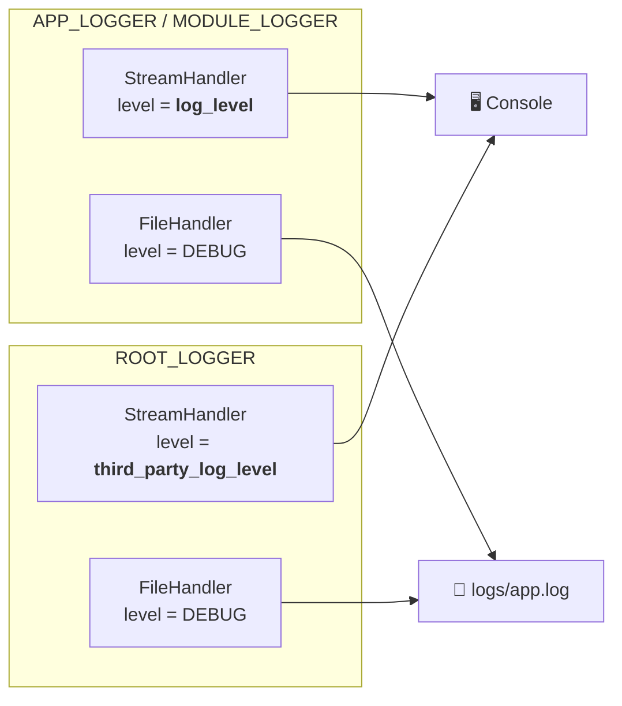

# Logging Internals

This page explains the internals of the logging system: why it's built the way it is and how each piece works. For everyday usage, see [Logging](../batteries/logging.md).

## Python's Logger Hierarchy

Python's `logging` module organizes loggers in a tree based on their dotted names. A logger named `a.b.c` is a child of `a.b`, which is a child of `a`. The `root` logger sits at the top.

When a logger emits a `LogRecord`, two things happen:

1. The logger passes the record to its own **handlers** (if the record's level meets the logger's threshold).
2. If `propagate = True` (the default), the record bubbles up to the **parent logger**, which repeats the process.

This continues until the record either reaches `root` or hits a logger with `propagate = False`.

!!! info "Levels on loggers vs. handlers"

    These serve different purposes:

    - **Logger level:** gate that decides whether a log record enters the system at all.
    - **Handler level:** gate that decides which records this specific output (console, file) emits.

    We set all logger levels to `DEBUG` so every record reaches the handlers. The handlers then decide what to emit based on their own levels.

## Architecture

Our logging system configures three loggers:

| Logger          | Name           | Purpose                                    |
| --------------- | -------------- | ------------------------------------------ |
| `APP_LOGGER`    | `project_base` | Your application code                      |
| `MODULE_LOGGER` | `__main__`     | Scripts run directly with `python file.py` |
| `ROOT_LOGGER`   | `root`         | Third-party libraries (catch-all)          |

### Why three loggers?

- **`APP_LOGGER`:** When you call `logging.getLogger(__name__)` inside your package, `__name__` resolves to something like `project_base.my_module`. Python's hierarchy makes this a child of the `project_base` logger. By configuring `project_base` with handlers and setting `propagate = False`, we capture all application logs and prevent them from reaching `root`.
- **`MODULE_LOGGER`:** Python sets `__name__` to `"__main__"` for the entry-point module. Since `"__main__"` is not a child of `"project_base"`, it would fall through to `root` and be treated as a third-party log. We configure it identically to `APP_LOGGER` to avoid this.
- **`ROOT_LOGGER`:** Everything else. Any logger not named `project_base.*` or `__main__` propagates up to `root`. By giving it a separate console handler with `third_party_log_level`, we keep noisy libraries quiet without silencing our own code.

### Propagation and `propagate = False`

The critical design decision is disabling propagation on both `APP_LOGGER` and `MODULE_LOGGER`.
Without this:

```
project_base.my_module → project_base → root
```

The log would be emitted by `project_base`'s handlers AND `root`'s handlers, producing **duplicate console output**. Setting `propagate = False` cuts the chain:

```
project_base.my_module → project_base  ✗→ root
```

## Handler Configuration

Each of the three loggers gets two handlers:



**StreamHandler (console):** controlled by the config level. Only logs at or above the threshold appear in your terminal.

**FileHandler:** always set to `DEBUG`. This is intentional! The log file is your safety net. When something goes wrong, you want the full picture regardless of what the console was showing.

### Why set logger levels to `DEBUG`?

Logger levels act as a pre-filter before records reach handlers. If a logger's level is `INFO`, a `DEBUG` record is discarded before any handler sees it, including the file handler.

Since we always want the file handler to capture everything, we set all logger levels to `DEBUG` and let handlers decide what to emit.

## The `CorrelationIdFormatter`

The `CorrelationIdFormatter` extends Python's `logging.Formatter` with correlation ID support.

## The `CorrelationIdFilter`

The `CorrelationIdFilter` from `asgi-correlation-id` reads a `ContextVar` and adds a `correlation_id` attribute to each `LogRecord`. The filter is attached to **handlers, not loggers**.

Why handlers? Because filters on a logger only apply to records emitted *by that logger directly*, not to records propagated from children. Since most of your logs come from child loggers (e.g., `project_base.my_module`), attaching the filter to the logger would miss them.

## The `InfiniteTimestampFileHandler`

This is a custom `RotatingFileHandler` that rolls over log files by **timestamp instead of sequential numbering**:

- When `logs/app.log` exceeds a certain size, it's renamed to e.g., `app_20250428T143000.123456Z.log`.
- A new, empty `app.log` starts receiving logs.
- Old files are never deleted (hence "infinite").

The microsecond precision in the timestamp avoids collisions when multiple rollovers happen within the same second.

## Uncaught Exception Hook

The system replaces `sys.excepthook` to log unhandled exceptions before Python's default behavior (which prints the traceback and exits):

This ensures that crashes are always persisted in the log file, even if the console output scrolls away or the process was running unattended.

## Single-Configuration Guard

`LoggingConfiguration` is a callable class that tracks whether it's been called before. A second call emits a warning and is a no-op. This prevents accidental double-configuration, which would attach duplicate handlers and produce repeated log lines.

## Warning Capture

`LoggingConfiguration._install_warnings_hook` ensures warnings emitted with `warnings.warn` are also logged. Those emitted from your package code are logged by a package logger, while those emitted by third parties are logged with the default `py.warnings` logger.

!!! note
    Practically, this means warnings end up in your log file alongside everything else, rather than going only to `stderr`.
